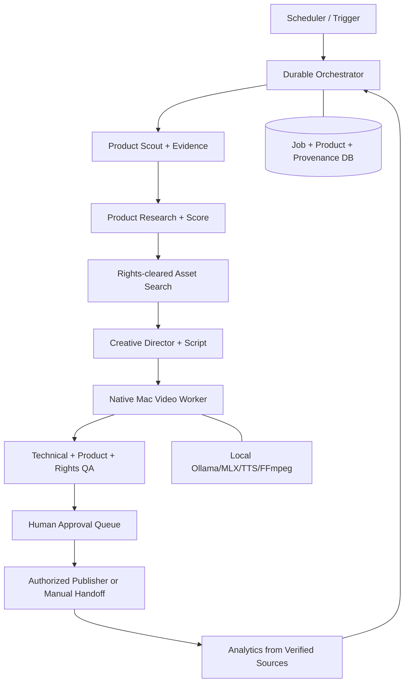

# System Architecture

## Recommended design
Standalone modular monolith with deterministic orchestrator, plug-in providers, local native video worker, and durable jobs. Separate repository and deployment from existing Studio. **Do not extract shared video-core until a measured need emerges.**

## Ownership boundaries
- `stp-aff-agent`: discovery, evidence, score, media rights, content generation, video production, QA, approval state, publishing adapters, analytics.
- `stp-aff-studio`: existing human-operated production Toolkit. Read-only reference; no runtime dependency initially.
- Possible future `stp-video-core`: only after compatibility and stable extraction strategy are proven.

## Interfaces (design contracts, not implemented)
- `ProductSource.search(criteria)->list[CandidateEvidence]`
- `OfferVerifier.verify(candidate)->OfferEvidence|Unknown`
- `AssetSource.search(product)->list[MediaAsset]`
- `RightsValidator.validate(asset, platforms)->RightsDecision`
- `Director.plan(product, assets)->StructuredVideoPlan`
- `Renderer.render(plan, assets)->MediaArtifact`
- `QA.check(package)->QAResult`
- `PublishingAdapter.publish(approved_package)->PublicationResult` (only where authorized)

## Failure behavior
- Missing rights: reject candidate and continue scouting within bounded budget.
- Unknown affiliate rate: keep unknown; do not fabricate.
- Model-invalid JSON: validate and retry boundedly.
- Render failure: persist logs/state; retry safely using idempotency key.
- Publication permission unavailable: provide manual upload package; do not automate browser workarounds.

## Mac→VPS migration
Today: native Ollama/MLX and FFmpeg on Mac; optional Docker Compose for API/DB/queue. Future: VPS hosts API, scheduler, DB, queue and media index; Mac worker polls securely outbound, retrieves signed media URLs, renders, uploads completed assets. Never require publicly exposing local model port.
