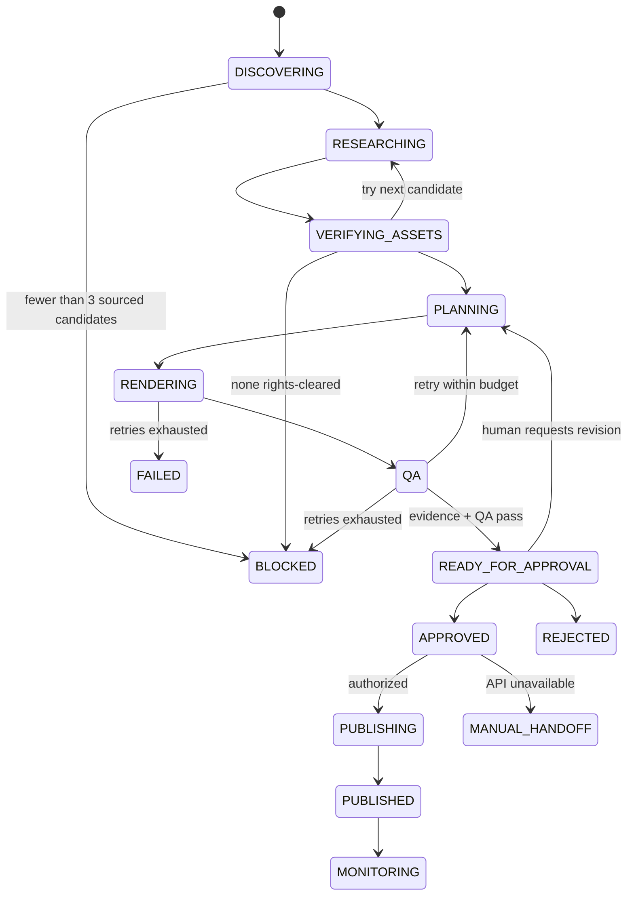

# Logical Agents & State Machine

Logical roles; **not nine separate LLMs**:

| Role | Responsibilities | Required evidence/output |
|---|---|---|
| Scout | candidate discovery | URLs, timestamps, source limitations |
| Research | product/offer facts | verified fields vs unknowns |
| Opportunity | deterministic ranking | score breakdown and reasons |
| Asset | source rights-cleared media | license grants and provenance |
| Creative | hook/script/scene plan | structured JSON with claim citations |
| Video Producer | TTS, subtitles, edit/render | MP4 + ffprobe metadata |
| QA | rights, product accuracy, video correctness | blocking/pass report |
| Publishing | approved packages, authorized integrations | platform-specific status |
| Analytics | views/orders/commissions | actual sourced metrics, attribution caveats |

## Target operating flow — bot prepares, human reviews at the end

This is the **target design**. The CLI now implements candidate fallback, documented-media checks, QA gates and versioned human revisions. A real end-to-end POC still needs an authorized source, real rights documents and a commercially permitted voice. Initial setup of those sources, credentials and rights remains an operator task. Missing evidence becomes `BLOCKED`.

```text
[Scheduled/manual trigger]
          |
          v
[BOT] Discover >=3 candidates from an authorized source; save source evidence
          |
          v
[BOT] Verify offer/product facts, rank deterministically
          |
          v
[BOT] Try candidate in rank order
      ├─ no documented media rights for Shopee + TikTok -> skip candidate
      └─ rights-cleared product media found -> continue
          |
          v
[BOT + AI Director] Evidence-grounded Thai plan, script and captions
          |
          v
[BOT] Licensed TTS -> render MP4/SRT -> technical/content/rights QA
      ├─ fixable failure -> bounded retry; then next candidate or BLOCKED
      └─ pass -> versioned package with evidence and QA report
          |
          v
[HUMAN] Watch/listen, inspect evidence, request revision/reject/approve
      ├─ revision -> BOT produces a new version -> HUMAN reviews again
      └─ approve -> authorized publishing adapter or manual handoff
```

The bot must stop with `BLOCKED` when fewer than three sourced candidates are available, no candidate has documented media rights, commercial voice rights are unverified, or the package cannot pass QA within the retry budget. Human approval applies to one specific package version. No publication occurs before that approval; an authorized publishing API, platform-required consent for that post, and approved app permissions are required for the bot to post after approval. Otherwise the operator receives a manual handoff.

### Implemented locally and remaining gaps

- `auto` accepts only CSV with source evidence or Shopee OpenAPI, requires three timestamped candidates, ranks by documented local media and tries the next candidate when a run fails. The dashboard bookmarklet is excluded from `auto`.
- A local rights registry ties exact listing URLs to media files and evidence documents. QA checks copied evidence hashes for every used image; it does not interpret the legal scope of a license. There is no autonomous media search adapter yet.
- Voice evidence is a blocking QA gate. The default Edge voice has no verified commercial grant in this repository, so current runs are blocked until a suitable provider and document are configured.
- QA checks MP4 metadata, declared rights, numeric/banned claims, captions and subtitle text/timing. Semantic accuracy, pronunciation and scene agreement still require the final human review.
- `revise` captures the reviewer instruction and avoid phrases, snapshots the old package and renders a new version. `decide approve --reviewed` checks QA and records hashes for the approved version. Publication remains manual.

### Implementation order before the Review web app

1. Replace routine manual exports with a verified authorized feed/API; require three sourced candidates and persist each candidate's source, timestamp and score. Without access, mark the batch `BLOCKED` rather than treating a dashboard bookmarklet as autonomous discovery.
2. Add a product-to-media rights registry and an asset search adapter. Require document evidence for every image/video and both target platforms, skip a candidate without it, then try the next candidate within a bounded budget.
3. Choose a TTS voice with documented permitted commercial use; make uncertain voice rights a blocking QA result. Keep the provider replaceable and record voice/license evidence in the package.
4. Extend automated QA to check rendered format, grounded claims, captions, subtitle timing and sampled scene/voice agreement. Escalate uncertain semantic findings to the final human review, never label them verified automatically.
5. Create a versioned package and queue only one that passed all machine-verifiable gates for human review. The reviewer can request a correction, reject or approve that exact version; the bot handles the correction loop.



`READY_FOR_APPROVAL` now requires the machine-verifiable QA gates, while the human checks legal scope, product truth and the actual clip. Each batch and run records states and evidence; an actual sourced, rights-cleared POC run is still pending. A candidate skipped for rights failure is not a completed job.
