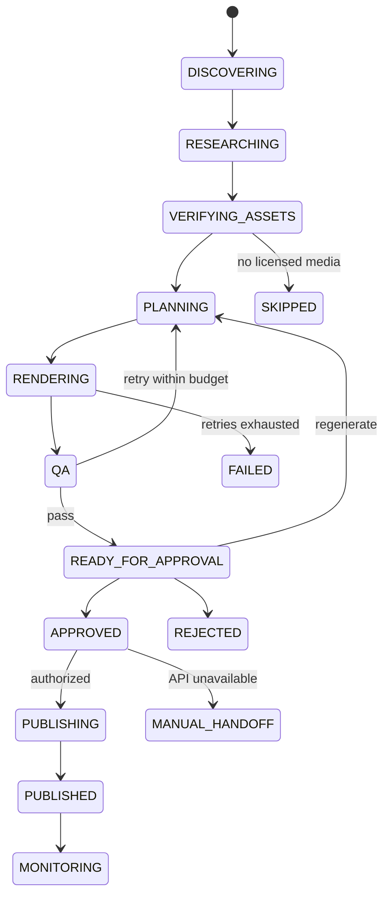

# Logical Agents & State Machine

Logical roles; **not nine separate LLMs**:

| Role | Responsibilities | Required evidence/output |
|---|---|---|
| Scout | candidate discovery | URLs, timestamps, source limitations |
| Research | product/offer facts | verified fields vs unknowns |
| Opportunity | deterministic ranking | score breakdown and reasons |
| Asset | source rights-cleared media | license grants and provenance |
| Creative | hook/script/scene plan | structured JSON with claim citations |
| Video Producer | TTS, subtitles, edit/render | MP4 + ffprobe metadata |
| QA | rights, product accuracy, video correctness | blocking/pass report |
| Publishing | approved packages, authorized integrations | platform-specific status |
| Analytics | views/orders/commissions | actual sourced metrics, attribution caveats |

Persist `run_id`, timestamps, state transitions, retry counts, errors, model versions, inputs/outputs, provenance, and human decisions. A candidate skipped for rights failure is not a completed job.
